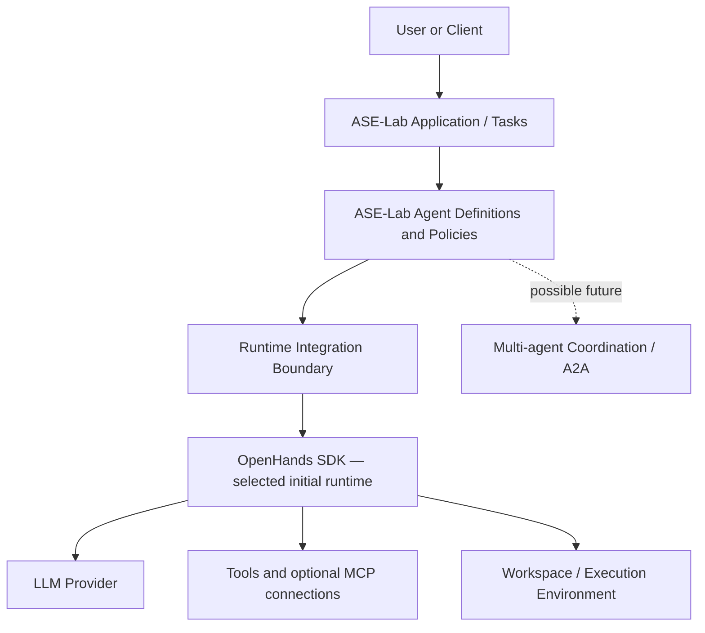

# Conceptual architecture

**Status:** Conceptual map; a small supervised subset was implemented privately.

The following diagram describes the broader direction, not deployed services or finalized module boundaries. The private [first-slice evaluation](../evaluation/first-slice.md) exercises only a small subset.

## Responsibility map

| Concern | Tentative responsibility | Current commitment |
| --- | --- | --- |
| Application and tasks | ASE-Lab-defined project semantics | Conceptual |
| Specialized agent configuration | ASE-Lab-owned task-specific behavior | Conceptual |
| Agent execution loop | OpenHands SDK for the initial implementation | Exercised in a private supervised run |
| Tooling and skills | Mix of SDK facilities and project extensions | Exploration |
| Runtime integration boundary | Keep project-owned code reasonably isolated | Small private command-line runner and worker adapter |
| Workspace and execution safety | Appropriate isolated or restricted environment | Requirement before unsafe execution |
| Multi-agent coordination | Only if real tasks justify it | Future possibility |

## Design considerations

- Understand the boundary between **the model**, **the agent execution loop**, **tool execution**, and **the application**.
- Avoid leaking unstable SDK internals throughout project-owned code where a thin integration boundary is sufficient.
- Keep the first integration interface as small as its actual use cases allow.
- Treat context management, planning, memory, and event tracing as concerns to study and place intentionally—not necessarily independent modules.
- Introduce permissions, limits, and isolation before running untrusted or model-generated commands.

## Future design questions

- Which task and report contracts should extend beyond the supervised [first slice](../planning/first-slice.md)?
- Which OpenHands extension points will be needed for a concrete next use case?
- What further observability and control evidence is needed before broader operation?

Future decisions should follow documented evidence. Update this diagram when those decisions change the broader design.
