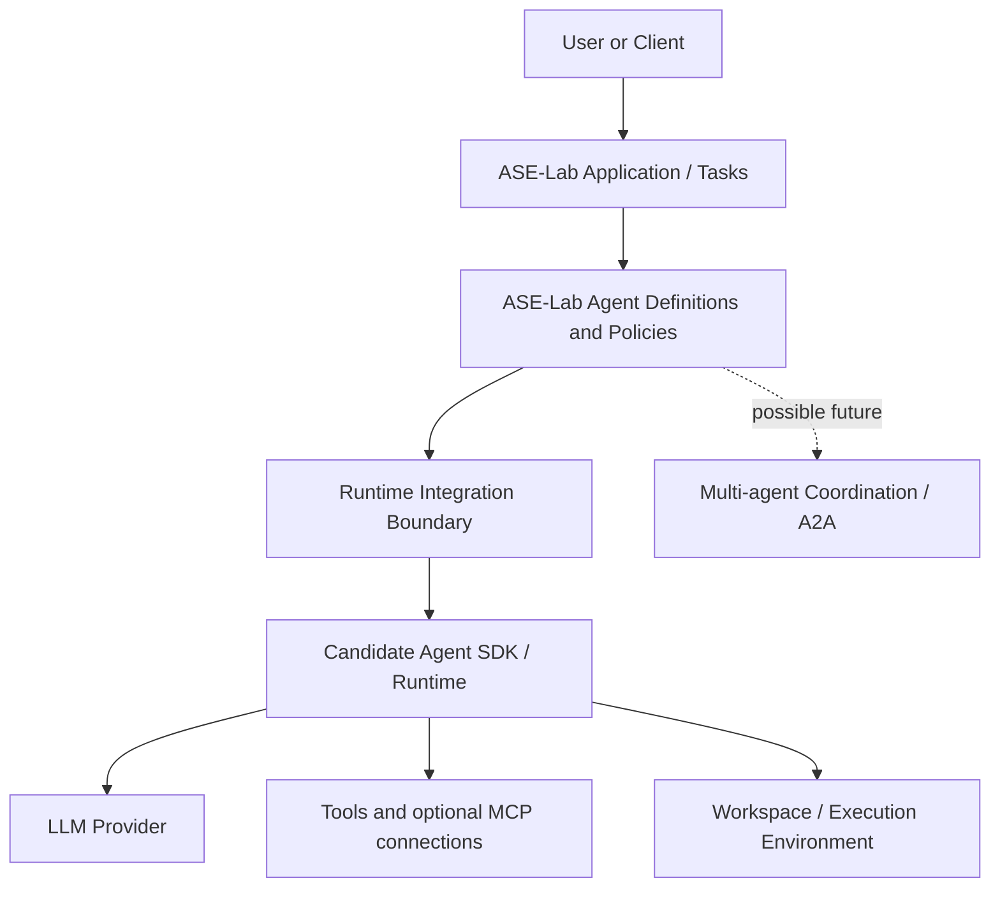

# Conceptual architecture

**Status:** Conceptual / not approved for implementation

The following diagram describes **possible responsibilities**, not deployed services, selected classes, or finalized module boundaries.

## Responsibility map

| Concern | Tentative responsibility | Current commitment |
| --- | --- | --- |
| Application and tasks | ASE-Lab-defined project semantics | Conceptual |
| Specialized agent configuration | ASE-Lab-owned task-specific behavior | Conceptual |
| Agent execution loop | Prefer an evaluated SDK where suitable | Direction, not final selection |
| Tooling and skills | Mix of SDK facilities and project extensions | Exploration |
| Runtime integration boundary | Keep project-owned code reasonably isolated | Principle; interface not designed |
| Workspace and execution safety | Appropriate isolated or restricted environment | Requirement before unsafe execution |
| Multi-agent coordination | Only if real tasks justify it | Future possibility |

## Design considerations

- Understand the boundary between **the model**, **the agent execution loop**, **tool execution**, and **the application**.
- Avoid leaking unstable SDK internals throughout project-owned code where a thin integration boundary is sufficient.
- Keep the first integration interface as small as its actual use cases allow.
- Treat context management, planning, memory, and event tracing as concerns to study and place intentionally—not necessarily independent modules.
- Introduce permissions, limits, and isolation before running untrusted or model-generated commands.

## Open questions

- Which SDK best supports the first selected software engineering use case?
- Which components should be extended via SDK APIs, and which, if any, require a fork?
- What is the smallest useful executable slice?
- Which observability and control mechanisms are essential for that slice?

The answers will follow documented feasibility work. This diagram should be updated whenever evidence changes the design.
